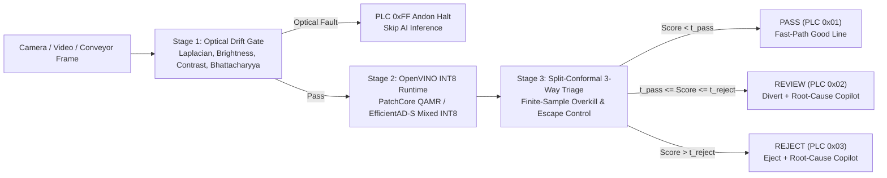

# EdgeLogic-AOI: Production Edge AOI Engine for Logical Assembly & Micro-Defect Inspection

[](https://opensource.org/licenses/MIT)
[](https://www.python.org/downloads/)
[](https://isocpp.org/)
[](https://www.intel.com/content/www/us/en/developer/tools/openvino-toolkit/overview.html)
[](https://github.com/openvinotoolkit/nncf)
[](https://github.com/openvinotoolkit/anomalib)

> **Industrial Automated Optical Inspection (AOI) platform for structural micro-defects (<0.2% area) and logical assembly violations.**  
> Combines **Unsupervised Anomaly Detection** (`PatchCore`, `EfficientAD`), **Intel NNCF Mixed-Precision INT8 + QAMR (Quantization-Aligned Memory Bank Re-indexing)**, **Station-Adaptive Optical Drift Gating**, **Split-Conformal 3-Way Triage**, a **C++17 OpenVINO Edge Engine**, and a **FastAPI + WebSocket Industrial Workbench**.

---

## System Architecture



---

## Verified Empirical Benchmarks

All metrics below are measured directly on **MVTec AD** and **MVTec LOCO AD** using the scripts in this repository (full JSON reports stored in `artifacts/reports/` and `artifacts/calibration/`).

### 1. Cloud GPU Training Suite (9 Models — Kaggle 2x T4 Parallel)

| Dataset | Category | Model | Image AUROC | Pixel AUROC | Optimal F1 |
| :--- | :--- | :--- | :---: | :---: | :---: |
| MVTec AD | `metal_nut` | PatchCore (`wide_resnet50_2`, coreset 0.1) | **0.9985** | 0.9869 | **0.9946** |
| MVTec AD | `transistor` | PatchCore (`wide_resnet50_2`, coreset 0.1) | **0.9954** | 0.9732 | **0.9630** |
| MVTec AD | `screw` | EfficientAD-S (70 epochs) | **0.9732** | 0.9833 | 0.9412 |
| MVTec AD | `screw` | PatchCore (`wide_resnet50_2`, coreset 0.1) | 0.9668 | **0.9890** | **0.9587** |
| MVTec AD | `metal_nut` | EfficientAD-S (70 epochs) | 0.9868 | 0.9687 | 0.9727 |
| MVTec AD | `transistor` | EfficientAD-S (70 epochs) | 0.9408 | 0.9296 | 0.8537 |
| MVTec LOCO | `splicing_connectors` | EfficientAD-M (70 epochs) | **0.8088** | — | — |
| MVTec LOCO | `splicing_connectors` | PatchCore (`wide_resnet50_2`, coreset 0.1) | 0.7870 | — | — |
| MVTec LOCO | `screw_bag` | EfficientAD-M (70 epochs) | 0.6005 | — | — |

### 2. Intel OpenVINO 2026.4 & NNCF Quantization Benchmark (Local Intel CPU, `mvtec_ad/screw`)

Standard Uniform PTQ INT8 degrades `PatchCore` sharply (`0.9510 -> 0.7661`) due to FP32 memory-bank distribution mismatch and `MatMul` L2 distance quantization error. Protecting sensitive ops via NNCF sensitivity profiling and re-indexing the memory bank from the INT8 backbone (**QAMR**) restores accuracy beyond FP32 while preserving **100% micro-defect recall**.

| Model & Precision Variant | Image AUROC | Micro-Defect Recall | P50 Latency | Async Throughput | Model Size |
| :--- | :---: | :---: | :---: | :---: | :---: |
| **PatchCore FP32** (OpenVINO IR) | 0.9510 | 95.83% | 21.90 ms | 67.9 FPS | 15.57 MB |
| **PatchCore Uniform PTQ INT8** | 0.7661 *(−18.5%)* | 91.67% | 13.74 ms | 106.6 FPS | 5.33 MB |
| **PatchCore NNCF + QAMR (`coreset=0.02`)** | **0.9699** | **100.00%** | **19.66 ms** | **67.3 FPS** | **12.43 MB** |
| **PatchCore NNCF + QAMR (`coreset=0.01`)** | 0.9412 | — | — | **82.4 FPS** | **7.62 MB** |
| **EfficientAD-S FP32** (OpenVINO IR) | 0.9846 | 91.67% | 253.74 ms | 6.4 FPS | 30.87 MB |
| **EfficientAD-S Uniform PTQ INT8** | 0.9785 | 87.50% *(Drop)* | 78.14 ms | 22.5 FPS | 7.96 MB |
| **EfficientAD-S NNCF Mixed INT8** | **0.9797** | **91.67%** *(0% Drop)* | **76.64 ms** | **22.9 FPS (`3.58x`)** | **7.96 MB (`3.88x`)** |

### 3. Factory Safety Layer Verification (Held-Out Validation)

* **Station-Adaptive Optical Drift Gate** (`python_research/calibration/drift_gate.py`): Auto-calibrates Laplacian blur, luminance, contrast, sensor clipping, and Bhattacharyya histogram thresholds from `train/good` percentiles (backlit-safe). Verified **30/30 (100%) Clean Pass** and **30/30 (100%) Blur/Dark/Glare Interlock Catch** on both `mvtec_ad/screw` and `mvtec_loco/splicing_connectors`.
* **Split-Conformal 3-Way Triage** (`python_research/calibration/conformal_triage.py`):
  * `PatchCore QAMR (screw)`: Overkill reduced from **14.29% -> 0.00%** (`0/21` good parts rejected), **66.67%** full automation rate.
  * `EfficientAD-S Mixed INT8 (screw)`: Overkill reduced from **47.62% -> 0.00%** (`0/21`), Escape **0.00%** (`0/60`), **75.31%** full automation rate.

---

## Project Structure

```text
EdgeLogic-AOI/
├── api/
│   ├── main.py                      # FastAPI REST + high-throughput binary WebSocket (/ws/inspect)
│   ├── engine_service.py            # Decoupled 4-stage inspection runtime & PLCInterface
│   └── static/                      # Industrial Technical Workbench UI (HTML/CSS/JS)
├── artifacts/
│   ├── calibration/                 # Drift baselines, score dumps & Conformal thresholds (.json)
│   └── reports/                     # Verified evaluation, sensitivity & quantization benchmarks
├── configs/                         # YAML configs for data, training, NNCF & calibration
├── cpp_edge_engine/                 # Pure C++17 OpenVINO Edge Engine (LATENCY & Async THROUGHPUT)
│   ├── CMakeLists.txt
│   ├── include/                     # aoi_engine.hpp, drift_gate.hpp, conformal_triage.hpp, metrics_timer.hpp
│   └── src/                         # C++17 implementations & CLI runner (main.cpp)
├── docker/
│   └── Dockerfile.edge              # Multi-stage OpenVINO Linux runtime build (dev -> runtime)
├── notebooks/
│   └── train_cloud_colab_kaggle.ipynb
├── python_research/
│   ├── data/                        # Micro-defect area analysis & dataset loaders
│   ├── training/                    # Anomalib training & evaluation scripts
│   ├── quantization/                # ONNX export, Uniform PTQ, NNCF sensitivity & QAMR Mixed INT8
│   ├── calibration/                 # Optical Drift Gate & Split-Conformal 3-Way Triage
│   └── vlm_copilot/                 # On-demand slow-path hotspot & root-cause explainer
└── tests/                           # PyTest suite (Drift Gate, Conformal, OpenVINO & API/WS)
```

---

## Quick Start

### 1. Environment Setup

```bash
git clone https://github.com/kietnguyenx/edgelogic-aoi.git
cd edgelogic-aoi
python -m venv .venv
# Windows:
.venv\Scripts\activate
# Linux/macOS:
source .venv/bin/activate

pip install -r requirements.txt
```

### 2. Launch the Industrial Inspection Workbench (FastAPI + WebSocket)

```bash
uvicorn api.main:app --host 127.0.0.1 --port 8088 --reload
```

Open `http://127.0.0.1:8088` in your browser to inspect:
* **Conveyor**: Live stream of real MVTec test parts through all 4 stages.
* **Image**: Single-image upload with interactive Jet heatmap opacity, ROI hotspot overlay, and JSON/key-value diagnostics.
* **Video & Live Camera**: Decoupled native-refresh-rate `requestAnimationFrame` rendering with binary WebSocket (`/ws/inspect`) inference streaming.
* **Benchmarks & MES Log**: Live empirical benchmark tables and PLC audit trail (`0x01 Pass`, `0x02 Divert`, `0x03 Eject`, `0xFF Andon`).

### 3. Run Quantization, Calibration & Unit Tests

```bash
# Export FP32 ONNX + OpenVINO IR with parity check
python python_research/quantization/export_onnx.py --model patchcore --dataset mvtec_ad --category screw

# Run NNCF sensitivity-guided Mixed INT8 + QAMR benchmark
python python_research/quantization/mixed_precision_nncf.py --model patchcore --dataset mvtec_ad --category screw --coreset 0.02

# Calibrate Optical Drift Gate & Split-Conformal 3-Way Triage
python python_research/calibration/drift_gate.py --dataset mvtec_ad --category screw
python python_research/calibration/conformal_triage.py --scores-json artifacts/calibration/scores_mixed_patchcore_mvtec_ad_screw.json

# Verify full test suite (Drift Gate, Conformal Triage, OpenVINO INT8, REST & WebSocket)
python -m pytest tests/ -v
```

### 4. Build & Run C++17 OpenVINO Edge Engine (Docker Multi-Stage)

```bash
docker build -f docker/Dockerfile.edge -t edgelogic-aoi-edge:latest .

# Single-stream LATENCY mode with full Drift Gate + Conformal PLC summary
docker run --rm -v "${PWD}/artifacts:/app/artifacts:ro" -v "${PWD}/data:/app/data:ro" \
  edgelogic-aoi-edge:latest --mode latency --limit 60

# Multi-stream Async THROUGHPUT benchmark
docker run --rm -v "${PWD}/artifacts:/app/artifacts:ro" -v "${PWD}/data:/app/data:ro" \
  edgelogic-aoi-edge:latest --mode throughput --limit 100
```

---

## Dataset Attribution & License

* Benchmarks use **MVTec AD** and **MVTec LOCO AD** published by **MVTec Software GmbH** (CC BY-NC-SA 4.0, used strictly for non-commercial research and portfolio benchmarking).
* Project source code is distributed under the **MIT License**.
