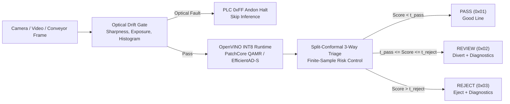

# EdgeLogic-AOI

[](https://opensource.org/licenses/MIT)
[](https://www.python.org/downloads/)
[](https://isocpp.org/)
[](https://www.intel.com/content/www/us/en/developer/tools/openvino-toolkit/overview.html)
[](https://github.com/openvinotoolkit/nncf)

**EdgeLogic-AOI** is an industrial Automated Optical Inspection (AOI) runtime for detecting structural micro-defects (<0.2% surface area) and logical assembly anomalies on edge CPUs. It pairs unsupervised anomaly detection (`PatchCore`, `EfficientAD`) with Intel NNCF mixed-precision INT8 quantization, optical drift interlocking, split-conformal 3-way triage, and a multi-stage C++17 OpenVINO edge engine.

---

## Architecture



### Core Engineering Highlights

* **Quantization-Aligned Memory Bank Re-indexing (QAMR) & NNCF Mixed INT8**: Uniform PTQ INT8 degrades `PatchCore` sharply (`0.9510 -> 0.7661` AUROC) due to FP32 memory-bank distribution drift and quantized L2 distance distortion. Sensitivity-guided op protection combined with INT8-aligned coreset re-indexing restores accuracy to **0.9699 AUROC** with **100% micro-defect recall**.
* **Factory Safety Interlocks**: A station-adaptive **Optical Drift Gate** halts inference (`0xFF`) under focus blur, underexposure, or glare; **Split-Conformal 3-Way Triage** routes borderline samples to human review (`0x02`) instead of false scrapping, reducing overkill to **0.00%**.
* **Dual Production Runtimes**:
  * **C++17 OpenVINO Edge Engine (`cpp_edge_engine/`)**: Zero-GIL Linux container (`openvino/ubuntu22_runtime`) supporting single-stream `LATENCY` and multi-stream async `THROUGHPUT`.
  * **Industrial Inspection Workbench (`api/`)**: FastAPI + binary WebSocket (`/ws/inspect`) live inspection UI with decoupled `requestAnimationFrame` rendering and PLC/MES audit logging.

---

## Verified Benchmarks

### 1. Detection Accuracy (MVTec AD & MVTec LOCO AD)

| Dataset | Category | Defect Scope | Selected Model | Image AUROC | Pixel AUROC | Optimal F1 |
| :--- | :--- | :--- | :--- | :---: | :---: | :---: |
| MVTec AD | `metal_nut` | Structural / Surface | PatchCore (`wide_resnet50_2`) | **0.9985** | 0.9869 | **0.9946** |
| MVTec AD | `transistor` | Electronics / Placement | PatchCore (`wide_resnet50_2`) | **0.9954** | 0.9732 | **0.9630** |
| MVTec AD | `screw` | Micro-Defect (<0.2% area) | EfficientAD-S / PatchCore | **0.9732** / 0.9668 | **0.9890** | **0.9587** |
| MVTec LOCO | `splicing_connectors` | Logical + Structural | EfficientAD-M | **0.8088** | — | — |

### 2. Intel OpenVINO & NNCF Quantization (`mvtec_ad/screw`, CPU)

| Model & Precision | Image AUROC | Micro-Defect Recall | P50 Latency | Async FPS | Size |
| :--- | :---: | :---: | :---: | :---: | :---: |
| PatchCore FP32 (OpenVINO IR) | 0.9510 | 95.83% | 21.90 ms | 67.9 | 15.57 MB |
| PatchCore Uniform PTQ INT8 | 0.7661 | 91.67% | 13.74 ms | 106.6 | 5.33 MB |
| **PatchCore NNCF + QAMR (`coreset=0.02`)** | **0.9699** | **100.00%** | **19.66 ms** | **67.3** | **12.43 MB** |
| EfficientAD-S FP32 (OpenVINO IR) | 0.9846 | 91.67% | 253.74 ms | 6.4 | 30.87 MB |
| EfficientAD-S Uniform PTQ INT8 | 0.9785 | 87.50% | 78.14 ms | 22.5 | 7.96 MB |
| **EfficientAD-S NNCF Mixed INT8** | **0.9797** | **91.67%** | **76.64 ms** | **22.9 (`3.58x`)** | **7.96 MB (`3.88x`)** |

### 3. C++17 Docker Edge Engine (`openvino/ubuntu22_runtime`, `-O3`)

End-to-end execution including OpenCV preprocessing, Optical Drift Gate, and Conformal PLC routing on `mvtec_ad/screw`:

| Model & Mode | Async Streams | P50 | P95 | P99 | Throughput |
| :--- | :---: | :---: | :---: | :---: | :---: |
| PatchCore QAMR INT8 (`--mode latency`) | 1 | **26.88 ms** | 37.64 ms | 61.96 ms | 35.35 FPS |
| PatchCore QAMR INT8 (`--mode throughput`) | 4 | 70.13 ms | 84.13 ms | 86.77 ms | **56.05 FPS** |
| EfficientAD-S Mixed INT8 (`--mode throughput`) | 6 | 257.41 ms | 295.75 ms | 312.24 ms | **22.92 FPS** |

### 4. Safety Layer Validation

* **Optical Drift Gate**: **100% (30/30)** clean pass rate and **100% (30/30)** fault catch rate across simulated blur, underexposure, and glare.
* **Split-Conformal 3-Way Triage** (held-out validation on `screw`):
  * `PatchCore QAMR`: Overkill reduced from **14.29% -> 0.00%**, **66.67%** full automation.
  * `EfficientAD-S Mixed INT8`: Overkill reduced from **47.62% -> 0.00%**, Escape **0.00%**, **75.31%** full automation.

---

## Repository Structure

```text
EdgeLogic-AOI/
├── api/                 # FastAPI REST/WebSocket runtime & Inspection Workbench UI
├── cpp_edge_engine/     # C++17 OpenVINO inference engine (Drift Gate, Conformal, Async pool)
├── docker/              # Multi-stage OpenVINO Linux Docker build
├── python_research/     # Training, NNCF/QAMR quantization, calibration & root-cause explainer
├── configs/             # Pipeline configuration files
└── tests/               # PyTest verification suite
```

---

## Quick Start

### 1. Workbench Server (FastAPI + WebSocket)

```bash
git clone https://github.com/kietnguyenx/edgelogic-aoi.git
cd edgelogic-aoi
python -m venv .venv && .venv/Scripts/activate   # Linux/macOS: source .venv/bin/activate
pip install -r requirements.txt

uvicorn api.main:app --host 127.0.0.1 --port 8088 --reload
```

Open `http://127.0.0.1:8088` to inspect Conveyor streams, static images, video files, or live camera feeds.

### 2. C++17 Edge Engine (Docker)

```bash
docker build -f docker/Dockerfile.edge -t edgelogic-aoi-edge:latest .

# Single-stream latency + PLC summary
docker run --rm -v "${PWD}/artifacts:/app/artifacts:ro" -v "${PWD}/data:/app/data:ro" \
  edgelogic-aoi-edge:latest --mode latency --limit 60

# Multi-stream async throughput
docker run --rm -v "${PWD}/artifacts:/app/artifacts:ro" -v "${PWD}/data:/app/data:ro" \
  edgelogic-aoi-edge:latest --mode throughput --limit 100
```

### 3. Verification Suite

```bash
python -m pytest tests/ -v
```

---

## Attribution & License

* Evaluated on **MVTec AD** and **MVTec LOCO AD** (MVTec Software GmbH, CC BY-NC-SA 4.0, non-commercial research & portfolio use).
* Source code is licensed under the **MIT License**.
